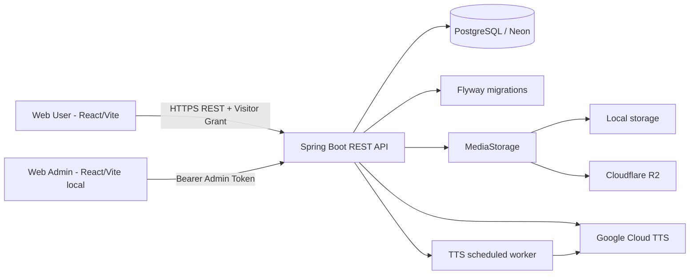
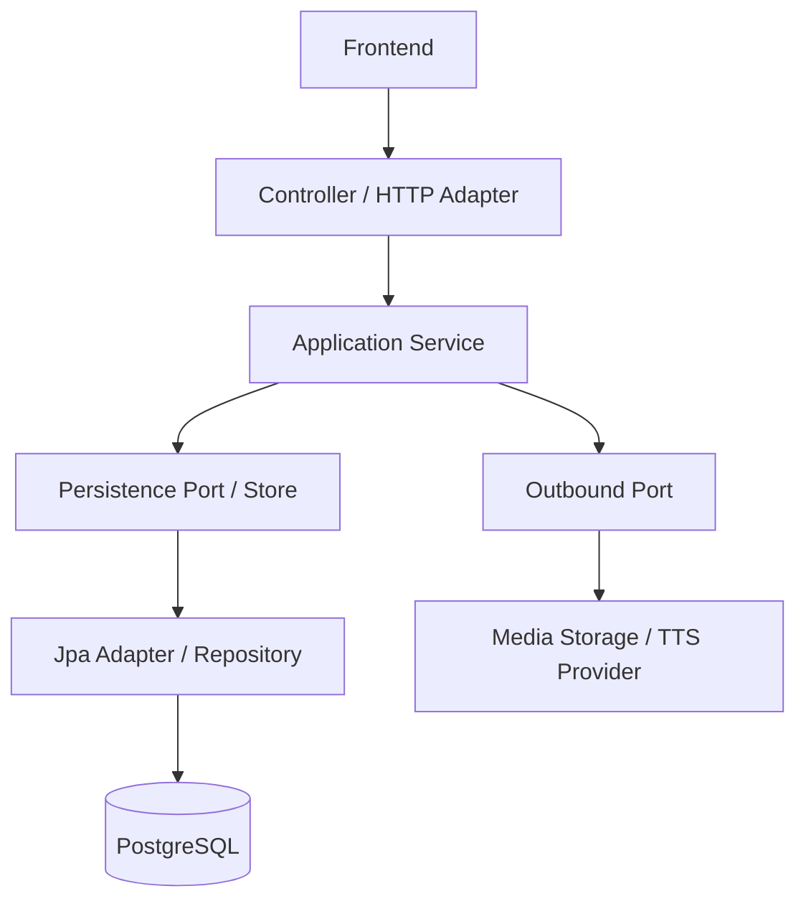

# Architecture — Multitional Translator

## 1. Trạng thái và phạm vi

Tài liệu mô tả mã nguồn hiện tại trong repository. Kiến trúc là Web User + Web Admin + một backend Spring Boot nguyên khối. Không có mobile app trong nhánh hiện tại.

- Web User phục vụ khách tham quan.
- Web Admin dùng chung cho ADMIN và SUPER_ADMIN, nhưng route và API quyền khác nhau.
- Backend là nguồn sự thật cho dữ liệu, trạng thái nghiệp vụ và phân quyền.
- Database PostgreSQL do Flyway quản lý.
- Media bytes nằm trong MediaStorage; database chỉ lưu metadata và storage_key.

Không thuộc phạm vi: Seller, Payment/Order, Seller reports, Dynamic RBAC, permission editor, mobile/offline pack và auto narration theo vị trí.

## 2. Sơ đồ hệ thống

Web User production và backend production chạy qua hosting công khai. Web Admin chạy local và gọi backend local-neon. Cả hai backend có thể cùng kết nối database Neon theo cấu hình môi trường, nhưng frontend không kết nối trực tiếp database.

## 3. Ứng dụng Frontend

### 3.1 Web User — apps/web

- Router: /welcome, /activate, / và /pois/:id.
- /welcome và /activate không yêu cầu grant; khám phá và chi tiết POI nằm sau RequireAccess.
- LanguageContext lấy danh sách ngôn ngữ từ GET /api/v1/public/languages; lựa chọn được lưu ở localStorage với key tm.lang.
- AccessContext lưu grant trên thiết bị, xác minh lại qua GET /api/v1/public/access/me và kết thúc phiên khi grant hết hạn/bị thu hồi.
- ScanPage hỗ trợ camera QR và nhập token/link thủ công.
- ExplorePage hiển thị bản đồ Leaflet, danh sách POI và tìm kiếm phía client.
- PoiDetailPage hiển thị nội dung, bản dịch, hình ảnh và audio theo ngôn ngữ.
- NarrationPlayer hỗ trợ play, pause, stop, seek và retry.
- API client tự gắn bearer grant và X-Device-Id cho request cần quyền.
- Analytics events được gửi cho session_start, poi_view và audio_play.

Không có offline cache/pack. Khi mất mạng, UI hiển thị cảnh báo hoặc lỗi và cho phép retry; không cam kết tiếp tục dùng tài nguyên offline.

### 3.2 Web Admin — apps/admin

- /login là trang đăng nhập.
- Các route nghiệp vụ yêu cầu phiên hợp lệ.
- ADMIN: /pois, /pois/new, /pois/:id, /access-qrs, /analytics.
- SUPER_ADMIN: /accounts, /audit.
- UI route guards cải thiện trải nghiệm; SecurityConfig và service kiểm tra quyền ở backend mới là ranh giới bảo mật.
- POI editor điều phối thông tin POI, bản dịch, hình ảnh và AudioPanel.
- AudioPanel hỗ trợ upload audio, yêu cầu TTS và polling trạng thái job.
- API client gắn opaque bearer token từ sessionStorage.

## 4. Backend

Backend là một ứng dụng Spring Boot, package gốc vn.edu.thuyetminh. Không tách microservice.

| Package | Trách nhiệm |
|---|---|
| access | Access QR, access package, grant, redeem và visitor authentication |
| admin | Quản lý tài khoản Admin |
| analytics | Nhận usage events và tổng hợp Analytics |
| audio | Audio metadata, trạng thái và truy vấn audio hiện hành |
| audit | Ghi và tra cứu Audit Log |
| auth | Admin account, login/logout, opaque bearer session, bootstrap |
| language | Danh sách ngôn ngữ đang bật |
| media | MediaStorage, upload validation, stream file |
| poi | POI, bản dịch, publish lifecycle và public query |
| tts | Provider TTS, job, worker và retry |
| common | Configuration, lỗi API, hashing và pagination |

### 4.1 Ranh giới xử lý

Luồng HTTP thông thường:

Controller nhận HTTP request, kiểm tra đầu vào ở boundary và gọi service. Service điều phối nghiệp vụ/giao dịch. Store interface tách service khỏi Spring Data trong các domain đã triển khai port. JPA adapters và Flyway sở hữu persistence concerns.

Đây chưa phải Clean Architecture thuần hoàn toàn: một số entity vẫn mang JPA annotations; application services vẫn dùng Spring transaction; TTS orchestration còn dùng transaction APIs của Spring.

### 4.2 POI và audio versioning

- POI có trạng thái DRAFT hoặc PUBLISHED và soft delete qua deleted_at.
- Public query chỉ trả POI đã publish và chưa soft-delete; POI nháp/đã xóa được che bằng 404.
- Bản dịch gắn với POI và language code.
- Khi narrationText thay đổi, contentVersion tăng và audio cũ trở thành STALE.
- Audio hiện hành phải READY và khớp contentVersion của bản dịch.
- Publish yêu cầu có bản dịch tiếng Anh và audio tiếng Anh hiện hành ở trạng thái sẵn sàng.
- TTS job lưu contentVersion tại thời điểm yêu cầu; kết quả của version cũ không được trở thành audio hiện hành.

### 4.3 Media

- MediaStorage có adapter local và R2.
- Database lưu storage_key, MIME, size, hash và trạng thái; không lưu bytes.
- User media yêu cầu grant; public URL chỉ có nghĩa là API path dành cho visitor đã xác thực, không phải truy cập ẩn danh.
- Admin media endpoint yêu cầu ADMIN.
- File upload được kiểm tra loại nội dung từ bytes và giới hạn kích thước ở backend.

### 4.4 TTS

- TTS là tác vụ bất đồng bộ, được lưu trong audio_generation_job.
- Worker chạy theo lịch mỗi 2 giây, xử lý tối đa 5 job mỗi tick.
- Job interrupted được phục hồi khi startup; job RUNNING cũ được rà soát mỗi 5 phút.
- Cấu hình mặc định: provider none, giới hạn 4500 byte UTF-8, timeout 30 giây, tối đa 3 lần thử.
- Google Cloud TTS cần Application Default Credentials và APP_TTS_PROVIDER=google.
- Mã tích hợp Google tồn tại nhưng không có bằng chứng gọi thành công Google thật trong lượt audit này; test hiện có không thay thế kiểm chứng credentials/provider thật.

## 5. Authentication và Authorization

### 5.1 Admin account

- Account role chỉ gồm ADMIN và SUPER_ADMIN.
- Login kiểm tra BCrypt password hash.
- Token là opaque bearer token tạo từ 32 byte SecureRandom; chỉ trả một lần.
- Database chỉ lưu SHA-256(token), thời hạn mặc định 8 giờ.
- Logout đặt revoked_at; disabled hoặc soft-deleted account không dùng được session.
- Token lưu phía Admin ở sessionStorage.
- Bootstrap account chỉ chạy khi APP_BOOTSTRAP_ADMIN_ENABLED=true, username/password hợp lệ; mật khẩu bootstrap tối thiểu 12 ký tự. Tắt bootstrap sau khi tạo account.

### 5.2 User grant

- User không có account đăng nhập.
- QR token dùng một lần; redeem tạo grant có thời hạn và ràng buộc deviceId.
- Database lưu SHA-256 của QR token, grant token và device ID.
- Mọi User API được bảo vệ yêu cầu visitor bearer token và X-Device-Id.
- Grant hết hạn, bị revoke hoặc gửi từ thiết bị khác không được xác thực.

### 5.3 Ma trận quyền thực thi

| Tài nguyên/API | VISITOR grant | ADMIN | SUPER_ADMIN |
|---|---:|---:|---:|
| GET public languages | Có, không cần grant | Có thể gọi public | Có thể gọi public |
| Redeem QR | Không cần grant | Không thay User | Không thay User |
| Public POI, image, audio, access/me, usage events | Có grant hợp lệ | Không có visitor grant mặc định | Không có visitor grant mặc định |
| Auth login | Không áp dụng | Không cần token | Không cần token |
| Auth logout/me | Không | Có | Có |
| Admin POI, translation, media, TTS, QR | Không | Có | 403 |
| Admin Analytics | Không | Có | 403 |
| Admin accounts | Không | 403 | Có |
| Admin audit | Không | 403 | Có |

SecurityConfig đặt matcher cụ thể Accounts/Audit/Analytics trước matcher /api/v1/admin/**. Các route không được cho phép bị deny mặc định. Không có Dynamic RBAC.

## 6. API error handling

GlobalExceptionHandler trả lỗi thống nhất gồm code, message, status, path, timestamp và fieldErrors khi có. Các trường hợp chính:

- 400: bad request/validation.
- 401: unauthenticated hoặc access grant không hợp lệ.
- 403: authenticated nhưng không đủ quyền.
- 404: tài nguyên không tồn tại hoặc POI không được công khai.
- 409: conflict, unique constraint hoặc optimistic-lock mismatch.
- 413: payload quá lớn.
- 415: media type không hỗ trợ.
- 500: lỗi nội bộ; không trả stack trace/secret.

## 7. External integrations và scheduled jobs

| Thành phần | Hiện trạng |
|---|---|
| Neon PostgreSQL | Backend kết nối qua JDBC; không có kết nối database từ browser |
| Cloudflare R2 | Có R2MediaStorage adapter và cấu hình theo environment |
| Google Cloud TTS | Có provider adapter; cần credentials thật để chạy |
| Leaflet / OpenStreetMap | Bản đồ Web User |
| Auth session cleanup | Mỗi giờ; xóa session expired/revoked cũ hơn một ngày |
| TTS worker | Mỗi 2 giây; tối đa 5 job/tick |
| TTS stale recovery | Mỗi 5 phút |
| Usage event retention cleanup | Không tìm thấy scheduled purge trong source hiện tại |

CI có GitHub Actions workflow. Không có workflow CD hoạt động trong .github/workflows; các tệp trong docs/cd-templates nếu còn là mẫu tham khảo, không phải deployment workflow đang chạy.

## 8. Testing

- Web User: Vitest + React Testing Library.
- Web Admin: Vitest + React Testing Library.
- Backend unit: Maven Surefire, loại trừ *IT.java.
- Backend integration: Maven Failsafe, chạy qua verify và cần PostgreSQL test riêng.
- CleanArchitectureBoundaryTest kiểm tra dependency boundary của controller/service/persistence.
- Test tồn tại không đồng nghĩa đã chạy; kết quả từng lượt phải ghi rõ trong DEVELOPMENT.md hoặc báo cáo nghiệm thu.

## 9. Những điểm không được mô tả như chức năng đã hoàn chỉnh

| Hạng mục | Bằng chứng hiện tại | Phân loại |
|---|---|---|
| Offline manifest | Có GET endpoint/service và được Admin E2E script gọi; không thấy Web User consumer hoặc UI offline pack | CODE_ONLY |
| Mobile app | Không có apps/mobile trong repository hiện tại | NOT_IMPLEMENTED |
| Auto narration/geofence | Không thấy route/UI/service triển khai | NOT_IMPLEMENTED |
| Dynamic RBAC | Không có permission editor; role tĩnh | NOT_IMPLEMENTED / ngoài phạm vi |
| Seller, Payment/Order | Không còn role/API/UI/schema Seller trong migration V6 hiện tại | NOT_IMPLEMENTED / ngoài phạm vi |
| Google TTS thật | Adapter có; chưa xác minh gọi provider thật | Chưa đủ bằng chứng vận hành |
| Usage event purge/retention | Không tìm thấy job purge | NOT_IMPLEMENTED |
| Audit cho mọi thao tác quản trị | Audit hiện có ghi account management và QR; không thấy ghi cho mọi thao tác POI/media/TTS | PARTIAL |

## 10. Liên kết truy vết

- Danh sách và đặc tả nghiệp vụ: [USE_CASES.md](USE_CASES.md)
- Schema, bảng và migrations: [DATABASE.md](DATABASE.md)
- Cài đặt, test, build và deploy: [DEVELOPMENT.md](DEVELOPMENT.md)
