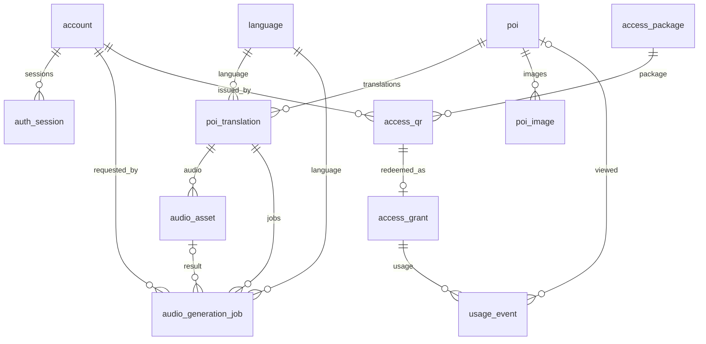

# Database — Multitional Translator

Snapshot khôi phục độc lập và bộ dữ liệu demo đã chuẩn hóa nằm tại [`database/`](../database/README.md): [`schema.sql`](../database/schema.sql) và [`demo-data.sql`](../database/demo-data.sql). Snapshot phản ánh schema sau Flyway V6; xem README để baseline Flyway đúng version khi restore.

## 1. Nguồn sự thật

Schema được quản lý bởi Flyway tại services/backend/src/main/resources/db/migration. Cấu hình JPA đặt ddl-auto=validate; Hibernate không tự tạo hoặc cập nhật schema.

Repository hiện có migration V1 đến V6. V6 loại bỏ role Seller, Seller-owned QR column/index và dữ liệu Seller thuộc phạm vi migration. Không sửa migration đã phát hành; mọi thay đổi schema mới phải dùng migration tiếp theo.

Tài liệu này mô tả schema trong migration repository. Trạng thái database đang chạy phải được xác minh qua Flyway schema history trên đúng database/branch; không suy ra trạng thái production chỉ từ file migration.

## 2. Danh sách bảng

Repository migrations định nghĩa 13 bảng nghiệp vụ:

| # | Bảng | Mục đích |
|---:|---|---|
| 1 | account | Tài khoản quản trị ADMIN/SUPER_ADMIN |
| 2 | auth_session | Opaque bearer sessions của Admin |
| 3 | language | Ngôn ngữ nội dung và TTS đang bật |
| 4 | poi | Địa điểm, tọa độ, trạng thái publish và soft delete |
| 5 | poi_translation | Nội dung POI theo ngôn ngữ và content version |
| 6 | audio_asset | Metadata audio upload/TTS |
| 7 | audio_generation_job | Tác vụ TTS bất đồng bộ |
| 8 | poi_image | Metadata ảnh POI và thứ tự hiển thị |
| 9 | access_package | Gói thời hạn grant khi redeem QR |
| 10 | access_qr | QR token dùng một lần |
| 11 | access_grant | Quyền User gắn thiết bị và thời hạn |
| 12 | audit_log | Sự kiện kiểm toán |
| 13 | usage_event | Sự kiện sử dụng cho Analytics |

Không có bảng Seller, payment, order, permission editor hoặc role-permission động trong schema migration hiện hành.

## 3. Bảng và trường chính

### account

- id BIGINT PK.
- username VARCHAR(64), unique trên account chưa soft-delete.
- password_hash VARCHAR(100), BCrypt.
- display_name VARCHAR(120), nullable.
- role VARCHAR(20), chỉ ADMIN hoặc SUPER_ADMIN.
- enabled BOOLEAN.
- created_at, updated_at TIMESTAMPTZ.
- deleted_at TIMESTAMPTZ nullable.
- deleted_by BIGINT nullable, FK về account.

### auth_session

- id BIGINT PK; account_id BIGINT FK account.
- token_hash VARCHAR(64), unique; chỉ lưu SHA-256 token.
- created_at, expires_at, last_used_at, revoked_at TIMESTAMPTZ.

### language

- code VARCHAR(10) PK.
- name, native_name, tts_language_code.
- default_tts_voice nullable.
- enabled BOOLEAN; sort_order INT.

Migration V2 thêm dữ liệu tham chiếu vi và en.

### poi

- id BIGINT PK; code VARCHAR(50) unique.
- default_name VARCHAR(200).
- latitude, longitude DOUBLE PRECISION.
- cover_image_key, cover_image_type.
- status DRAFT hoặc PUBLISHED.
- is_demo BOOLEAN; published_at TIMESTAMPTZ.
- created_at, updated_at TIMESTAMPTZ; row_version BIGINT.
- category VARCHAR(100); trigger_radius DOUBLE PRECISION.
- deleted_at TIMESTAMPTZ nullable.

### poi_translation

- id BIGINT PK; poi_id BIGINT FK poi.
- language_code VARCHAR(10) FK language.
- name VARCHAR(200); description TEXT nullable; narration_text TEXT.
- content_version INT; created_at, updated_at TIMESTAMPTZ.
- UNIQUE(poi_id, language_code).

### audio_asset

- id BIGINT PK; translation_id BIGINT FK poi_translation.
- content_version INT; storage_key VARCHAR(255) unique.
- source UPLOAD/TTS; format mp3/m4a/wav/ogg.
- mime_type, size_bytes, sha256.
- status READY/STALE.
- content_hash nullable for uploaded assets; tts_voice, original_filename, created_at.

### audio_generation_job

- id BIGINT PK; translation_id BIGINT FK poi_translation.
- content_version, content_hash, language_code, tts_voice.
- status QUEUED/RUNNING/SUCCEEDED/FAILED.
- attempts, max_attempts, next_attempt_at.
- error_code, error_message.
- audio_asset_id FK audio_asset, requested_by FK account.
- created_at, started_at, finished_at, updated_at.

### poi_image

- id BIGINT PK; poi_id BIGINT FK poi.
- storage_key VARCHAR(255) unique; mime_type.
- sort_order INT; created_at TIMESTAMPTZ.

### access_package

- id BIGINT PK; code VARCHAR(40) unique.
- name VARCHAR(120); duration_minutes INT > 0.
- active BOOLEAN; created_at TIMESTAMPTZ.
- V4 seeds DEMO_24H with 1440 minutes.

### access_qr

- id BIGINT PK; token_hash VARCHAR(64) unique.
- package_id BIGINT FK access_package.
- status ISSUED/REDEEMED/REVOKED.
- note VARCHAR(200); issued_by BIGINT FK account nullable.
- created_at, redeemed_at, revoked_at TIMESTAMPTZ.
- No seller_id in the V6 schema.

### access_grant

- id BIGINT PK; qr_id BIGINT FK access_qr, unique.
- token_hash VARCHAR(64) unique; device_hash VARCHAR(64).
- created_at, expires_at, revoked_at TIMESTAMPTZ.
- UNIQUE(qr_id) ensures one grant per QR.

### audit_log

- id BIGINT PK; occurred_at TIMESTAMPTZ.
- actor_id BIGINT nullable; actor_name snapshot.
- action, resource_type, resource_id.
- result SUCCESS/DENIED/FAILURE.
- detail TEXT; no password or raw bearer/QR token should be stored.

### usage_event

- id BIGINT PK; event_type poi_view/audio_play/session_start.
- grant_id BIGINT FK access_grant.
- poi_id BIGINT FK poi, nullable with ON DELETE SET NULL.
- event_id VARCHAR(64), optional unique when present.
- occurred_at TIMESTAMPTZ.

## 4. ERD

Audit actor_id is a historical identifier/snapshot and is not declared as a foreign key in V5. Account deletion therefore does not erase the audit record through a cascade.

## 5. Quan hệ và ràng buộc quan trọng

- account.username unique khi deleted_at IS NULL; role CHECK chỉ ADMIN/SUPER_ADMIN.
- auth_session.token_hash unique; account_id references account.
- poi.code unique; latitude trong -90..90; longitude trong -180..180.
- poi.status chỉ DRAFT/PUBLISHED; trigger_radius từ 1 đến 5000.
- poi_translation unique theo (poi_id, language_code); narration_text không rỗng; content_version >= 1.
- audio_asset.storage_key unique; source/format/status bị giới hạn bởi CHECK; size_bytes > 0.
- audio_generation_job chỉ có một job QUEUED/RUNNING cho cùng translation_id + content_hash qua partial unique index.
- poi_image.sort_order >= 0.
- access_qr.token_hash unique; status chỉ ISSUED/REDEEMED/REVOKED.
- access_grant unique theo qr_id và token_hash.
- usage_event.event_type chỉ poi_view/audio_play/session_start; event_id unique khi khác NULL.
- Các index phục vụ status/time, actor/time, POI, job scheduling và truy vấn audio hiện hành.

## 6. Flyway migrations

| Migration | Nội dung |
|---|---|
| V1__init_schema.sql | account, auth_session, language, poi, poi_translation, audio_asset, audio_generation_job và các constraint/index ban đầu |
| V2__reference_languages.sql | Seed language vi/en |
| V3__align_poi_admin_uc10.sql | category, trigger_radius, soft delete POI và poi_image; chuyển cover image hiện hữu thành ảnh đầu tiên |
| V4__access_qr_grant.sql | access_package, access_qr, access_grant và gói DEMO_24H |
| V5__seller_audit_analytics.sql | deleted_at/deleted_by account, audit_log, usage_event và schema Seller tạm thời |
| V6__remove_seller_role_and_data.sql | Xóa Seller accounts, Seller-owned QR/grants/usage và Seller-only audit events; bỏ seller_id/index; giới hạn role còn ADMIN/SUPER_ADMIN |

Không sửa các migration đã chạy trên bất kỳ môi trường dùng chung nào. Tạo migration mới, review SQL và kiểm thử trên database riêng trước khi áp dụng.

## 7. Demo data

Dữ liệu demo nằm trong db/demo: V100 demo POIs, V101 demo Admin accounts, V102 demo access QR. Đây không phải migration schema thông thường. Chỉ profile dev thêm classpath:db/demo và bật out-of-order cho seed V100+. Profile local-neon và prod chỉ dùng db/migration, không nạp demo seed. Tài khoản demo và QR mẫu được mô tả trong [demo README](../services/backend/src/main/resources/db/demo/README.md); mật khẩu/QR mẫu yếu và chỉ dùng local.

## 8. Media storage

PostgreSQL chỉ lưu metadata và storage_key. Bytes được lưu qua MediaStorage adapter:
- local: APP_STORAGE_LOCAL_ROOT, mặc định ./data/media.
- R2: APP_STORAGE_PROVIDER=r2 cùng endpoint, bucket, access key và secret từ environment.

Không lưu absolute URL hoặc credentials trong database. Backup database và object storage phải nhất quán để storage_key không trỏ tới file bị thiếu.

## 9. Data lifecycle và giới hạn đã xác minh

- POI và Admin account hỗ trợ soft delete.
- QR revoke sẽ revoke grant tương ứng nếu QR đã redeem.
- Thay narration sẽ làm audio version cũ thành STALE.
- Access grant gắn với device_hash và expires_at.
- Session cleanup có scheduled job trong AuthService.
- Không tìm thấy scheduled purge cho usage_event trong source hiện tại; không ghi tài liệu rằng retention 90 ngày đã được thực thi.
- Audit API chỉ đọc; không có endpoint sửa/xóa Audit Log. Điều này không đồng nghĩa database có cơ chế chống sửa đổi tuyệt đối trước truy cập SQL trực tiếp.

## 10. Cách kiểm tra database

- Đọc Flyway migration files trước khi thay đổi schema.
- Xác minh đúng database/branch trước mọi thao tác ghi.
- Kiểm tra flyway_schema_history trên database mục tiêu.
- Dùng database test riêng cho integration tests; không chạy test hoặc destructive script trên production.
- Không ghi connection string, password, token hoặc dữ liệu nhạy cảm vào log/tài liệu.

Xem thêm [Development](DEVELOPMENT.md) và [Neon database cheatsheet](NEON_DATABASE_CHEATSHEET.md).
