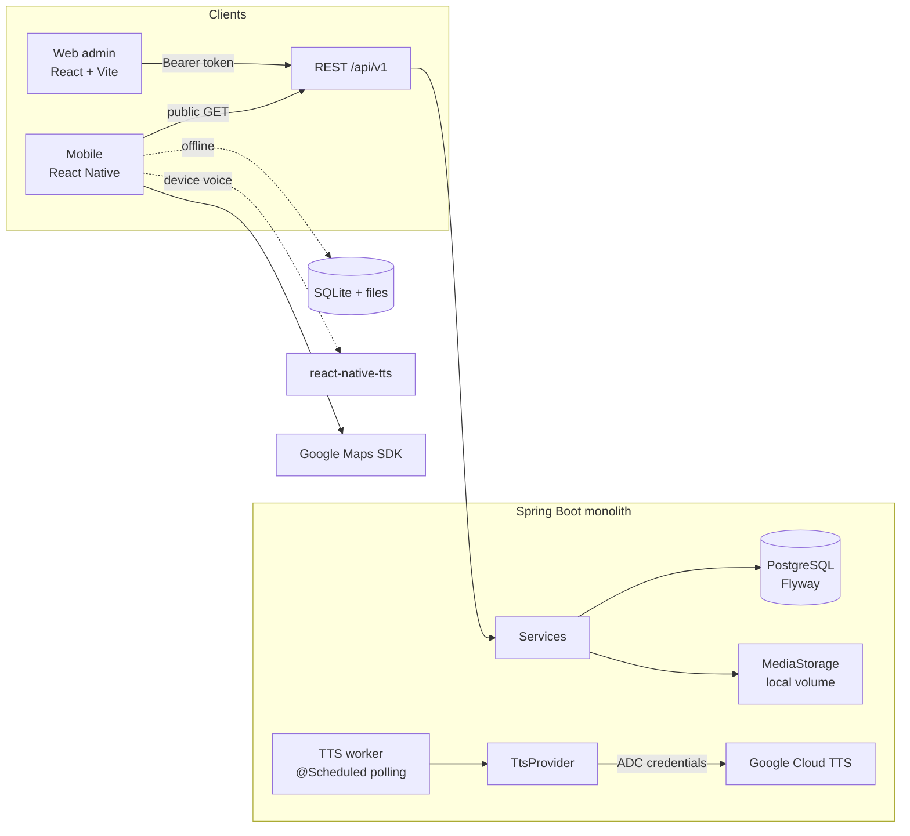
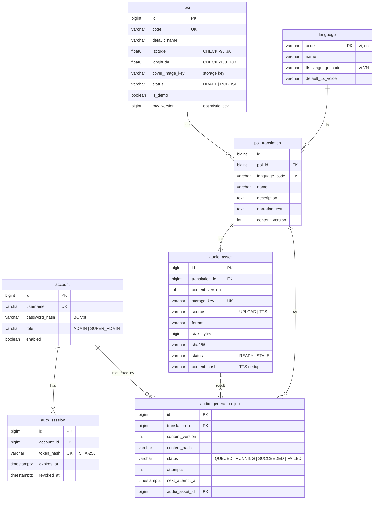
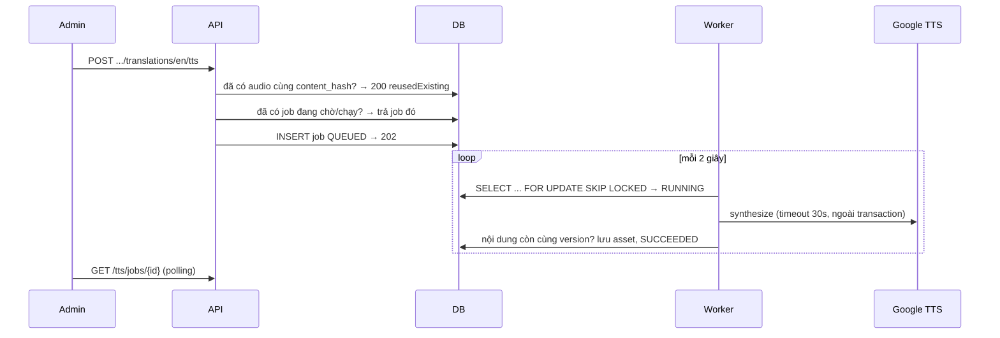

# Kiến trúc

> **Trạng thái tài liệu:** Mô tả kiến trúc/mã nguồn hiện có. Đặc tả nghiệp vụ đích đã chuyển sang website User online-only với Seller/QR theo `docs/requirements/Use_Case_Specification_Final_15_UC.md`. Các mô tả mobile/offline bên dưới là hiện trạng legacy, không được hiểu là phạm vi nghiệp vụ đích; cần thiết kế và triển khai migration riêng.

## Tổng quan

Backend là **một ứng dụng** chia module theo chức năng (package `vn.edu.thuyetminh.*`):

| Module | Trách nhiệm |
|---|---|
| `auth` | Account, phiên đăng nhập (token), Spring Security, bootstrap admin |
| `language` | Danh mục ngôn ngữ |
| `poi` | POI, nội dung theo ngôn ngữ, API admin/public, manifest offline |
| `audio` | Metadata audio, upload, xác định audio hiện hành, seed demo (dev) |
| `tts` | `TtsProvider`, job bất đồng bộ bền vững, worker |
| `media` | `MediaStorage` (local), nhận dạng định dạng theo magic bytes, stream file (hỗ trợ HTTP Range) |
| `common` | Lỗi thống nhất, phân trang, cấu hình `app.*`, OpenAPI |

Mỗi module tách Controller → Service → Repository → Entity; API chỉ trả **DTO** (record), không trả Entity.

## ERD

Ràng buộc chính (xem `services/backend/src/main/resources/db/migration/V1__init_schema.sql`):

- `UNIQUE (poi_id, language_code)` trên `poi_translation`.
- `CHECK` toạ độ, trạng thái, nguồn audio, định dạng; `narration_text` không rỗng.
- Partial unique index `uq_job_active_content`: tối đa một job đang chờ/chạy cho cùng nội dung.
- Index cho truy vấn danh sách, audio hiện hành, worker (`status, next_attempt_at`).
- File audio/ảnh **không** lưu trong PostgreSQL; chỉ lưu `storage_key` tương đối (không có host).

Dữ liệu mẫu: `db/demo/V100__demo_pois.sql` chỉ nạp với profile `dev` (đánh dấu `is_demo = true`, tên có `[DEMO]`).

## Không phát nhầm audio phiên bản cũ

1. `poi_translation.content_version` tăng mỗi khi `narration_text` thay đổi (đổi tên/mô tả không tăng).
2. Mỗi `audio_asset` ghi `content_version` mà nó được tạo cho.
3. Khi nội dung thay đổi: mọi asset `READY` của bản dịch chuyển sang `STALE`.
4. "Audio hiện hành" = `READY` **và** `content_version` bằng của bản dịch. API public, URL stream và manifest offline đều áp dụng điều kiện này (audio cũ trả 404).
5. Job TTS ghi `content_version` lúc yêu cầu; nếu nội dung đổi trong lúc job chạy, kết quả bị huỷ (`CONTENT_CHANGED`) và không lưu file.
6. Mobile chỉ dùng file local hoặc audio online có cùng `content_version` với nội dung đang hiển thị.

## Xác thực admin — lựa chọn và lý do

**Cơ chế:** token mờ (opaque bearer token) lưu phía server.

- `POST /api/v1/auth/login` kiểm tra mật khẩu bằng **BCrypt** (Spring Security `BCryptPasswordEncoder`), sinh 32 byte ngẫu nhiên (`SecureRandom`), trả token **một lần**.
- DB chỉ lưu **SHA-256(token)** + `expires_at` (mặc định 8 giờ, tuyệt đối) — lộ DB không lộ token dùng được.
- Mọi request admin gửi `Authorization: Bearer <token>`; filter tra bảng `auth_session`.
- `POST /api/v1/auth/logout` đặt `revoked_at` → token **hết hiệu lực ngay** (logout thực sự). Phiên hết hạn được dọn định kỳ.
- Tài khoản bị `enabled = false` thì mọi token của nó bị từ chối.

**Vì sao không dùng JWT:** JWT không thu hồi được trước hạn nếu không có danh sách chặn — tức vẫn cần tra DB. Token mờ đơn giản hơn và logout thật.

**Vì sao không dùng cookie session:** admin (Vercel) và backend (Render) khác site; cookie cross-site cần `SameSite=None; Secure` + CSRF token + CORS credentials, phức tạp hơn cho MVP.

**CSRF:** tắt CSRF là có chủ đích và an toàn trong mô hình này vì trình duyệt **không tự gửi** header `Authorization` (CSRF khai thác thông tin xác thực tự động như cookie). Nếu sau này chuyển sang cookie thì **phải** bật lại CSRF.

**Lưu token phía admin:** `sessionStorage` (theo tab, mất khi đóng tab) + bộ nhớ. Rủi ro: XSS trên origin admin có thể đọc token → admin không render HTML không tin cậy, token có hạn ngắn, header bảo mật trong `vercel.json`. Không lưu token trong URL hay `localStorage`.

**Phân quyền:** kiểm tra ở backend (`/api/v1/admin/**` yêu cầu `ROLE_ADMIN`/`ROLE_SUPER_ADMIN`). API public chỉ đọc và luôn lọc `status = PUBLISHED` (POI nháp trả 404 cả ở danh sách, chi tiết, manifest, audio, ảnh).

**CORS:** đọc từ `APP_CORS_ALLOWED_ORIGINS`; không dùng credentials/cookie.

## TTS bất đồng bộ

- `content_hash = SHA-256(provider, mã ngôn ngữ TTS, giọng, MP3, văn bản)` → tránh gọi lại khi không có gì thay đổi.
- Lỗi tạm thời (UNAVAILABLE, DEADLINE_EXCEEDED, RESOURCE_EXHAUSTED, timeout…) được thử lại tối đa `APP_TTS_MAX_ATTEMPTS` lần với backoff 5s, 10s, 20s…; lỗi khác thất bại ngay.
- Khởi động lại: job đang `RUNNING` được xếp lại hàng (hoặc `FAILED` nếu hết lượt). Định kỳ có bước dọn job `RUNNING` quá 10 phút.
- Giới hạn độ dài: `APP_TTS_MAX_INPUT_BYTES` (mặc định 4500 byte UTF-8, dưới giới hạn 5000 byte của Google).
- Lỗi TTS không ảnh hưởng POI (POI vẫn công khai, mobile đề xuất giọng thiết bị).
- Khi không có credential: `TtsProvider` = `DisabledTtsProvider`, API trả `503 TTS_NOT_CONFIGURED`; **không** tạo audio giả.

## Mobile

| Thành phần | Vai trò |
|---|---|
| `audio/NarrationPlayer` + `SoundNarrationPlayer` | Abstraction phát file (react-native-sound) |
| `audio/narrationController` | Một nguồn phát duy nhất; đổi POI/ngôn ngữ/nguồn luôn dừng nguồn cũ |
| `audio/sourceResolver` | Ưu tiên: file local hợp lệ → audio online (khi có mạng) → đề xuất giọng thiết bị |
| `audio/deviceTts` + `voiceSelection` | Kiểm tra engine, giọng đúng ngôn ngữ, đã cài, offline-capable; chia đoạn văn bản dài |
| `offline/offlineManager` | Tải manifest + audio, kiểm tra size + SHA-256, retry, dọn file cũ, xoá |
| `storage/db` | SQLite (op-sqlite): settings, metadata/nội dung offline |
| `@dr.pogodin/react-native-fs` | Lưu file audio trong thư mục riêng của ứng dụng |

## Kiến trúc đích Seller/Payment/QR cho demo — chưa triển khai/xác minh

- **Seller Transaction API:** tạo giao dịch gói `DEMO_24H`, giá 1 VND; kiểm tra ownership ở backend; chỉ hủy trước redeem.
- **VNPAY Sandbox Adapter:** chỉ dùng endpoint/credentials sandbox. Backend xác minh chữ ký, mã tham chiếu, số tiền và trạng thái. Return URL của trình duyệt không phải bằng chứng thanh toán.
- **Payment reconciliation:** callback lặp phải idempotent. Sai lệch giao dịch chuyển trạng thái cần kiểm tra, không tự đánh dấu thành công.
- **One-time QR redeemer:** redeem trong transaction nguyên tử, xác minh payment và trạng thái QR trước khi đánh dấu đã dùng/tạo grant.
- **User access grant:** lưu `activated_at`, `expires_at` và trạng thái; `expires_at = activated_at + 24 hours`. Mọi API User cần grant hợp lệ ở backend, trừ luồng cần thiết để xem/đổi QR và lỗi.
- **Analytics/Audit:** ghi các sự kiện nghiệp vụ đã chốt, không ghi token QR/credential dạng rõ; tách quyền đọc/ghi audit và xác định retention/backup trước production.

### Entity/thuộc tính đích cần xem xét trong ERD/Data Dictionary

Các mục sau là dữ liệu mục tiêu, chưa khẳng định schema hiện tại đã có:

- `service_package`: mã `DEMO_24H`, giá 1 VND, thời hạn 24 giờ, trạng thái bật/tắt.
- `seller_transaction`: Seller, package, số tiền, phương thức, trạng thái, thời điểm tạo/hủy/xác nhận và tham chiếu thanh toán.
- `payment_notification`: provider event/reference, kết quả xác minh chữ ký, idempotency và thời điểm nhận; chỉ lưu payload tối thiểu đã làm sạch.
- `access_qr`: token hash, trạng thái, `redeemed_at`, `revoked_at`; không có hạn tự hết hiệu lực trước lần redeem đầu tiên, nhưng có thể bị thu hồi. UC12/luồng tạo QR ngoài MVP.
- `user_access_grant`: transaction/QR, `activated_at`, `expires_at`, trạng thái và binding phiên/credential.
- `usage_event`/`analytics_read_model`: loại sự kiện, POI, locale, timestamp và metadata tối thiểu.
- `audit_record`: actor, action, resource, timestamp, outcome và metadata đã loại bỏ secret.

### NFR mục tiêu MVP (chưa đo kiểm)

| Hạng mục | Mục tiêu đề xuất | Xác minh |
|---|---|---|
| API thường | P95 < 500 ms | Load test với môi trường/dataset được ghi rõ |
| Redeem QR + grant | P95 < 1 giây, không tính hệ thống ngoài | Load/race-condition test |
| Trang User chính | Tải < 3 giây trong điều kiện đo xác định | Browser performance test |
| Tính đúng đắn | Không grant trùng, QR một lần, callback idempotent | Integration/concurrency tests |
| Bảo mật | Authorization, IDOR, replay, expiry, chữ ký/số tiền sai | Negative security tests |
| Khả dụng/khôi phục | Mục tiêu tham khảo 99,5%/tháng; RPO ≤ 24h; RTO ≤ 8h nếu có backup | Monitoring và restore drill; chưa đo kiểm |

VNPAY Sandbox chỉ phục vụ demo/test. Các endpoint/entity trên là thiết kế mục tiêu, không phải bằng chứng đã triển khai.

## Quy tắc dữ liệu xuyên suốt: soft delete và khả năng mở rộng

- Mọi thực thể nghiệp vụ có thể xóa dùng soft delete (`deleted_at`, `deleted_by` hoặc tương đương); truy vấn mặc định loại bản ghi đã xóa. Không hard-delete qua UI/API thông thường; giữ khóa ngoại, lịch sử và audit. Khôi phục cần quyền riêng và audit event.
- Audit log append-only; lưu tối thiểu 24 tháng theo mục tiêu hiện tại, backup hằng ngày và kiểm thử khôi phục định kỳ. Chính sách phải được rà soát trước production.
- Locale được quản lý bằng bảng/cấu hình và khóa locale chuẩn, không enum cố định chỉ gồm `vi`/`en`; MVP chỉ bật hai locale này. Fallback là chính sách dữ liệu/tài nguyên, không phải nhánh hard-code theo từng ngôn ngữ.
- Gói dịch vụ là dữ liệu cấu hình (mã, giá, currency, duration, trạng thái/phiên bản điều kiện); không hard-code một gói. UC12 và việc tạo QR nội bộ ngoài MVP.