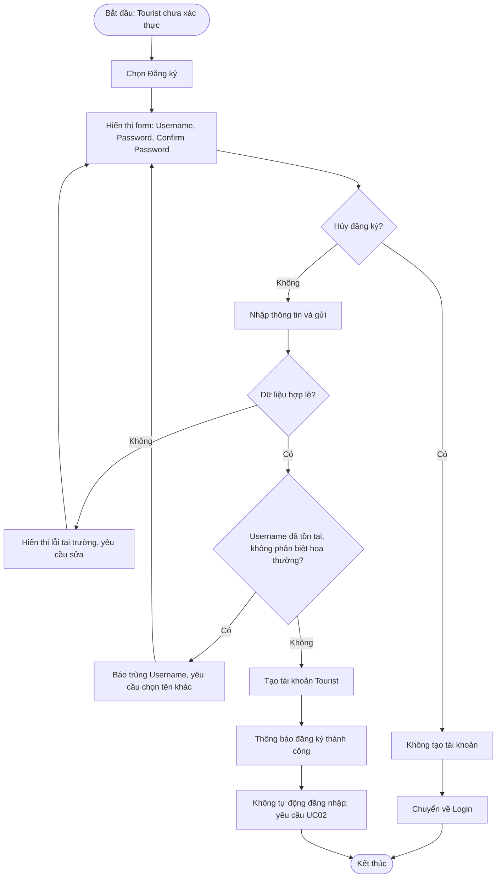

# UC01 — Đăng ký tài khoản

**Actor:** Tourist  
**Nguồn đặc tả:** `docs/requirements/Use_Case_Specification_Final_16_UC.md`

**Quy tắc chính:** Username 3–20 ký tự theo quy tắc đặc tả; Password tối thiểu 6 ký tự và phải khớp Confirm Password. Không hợp lệ thì không tạo tài khoản.