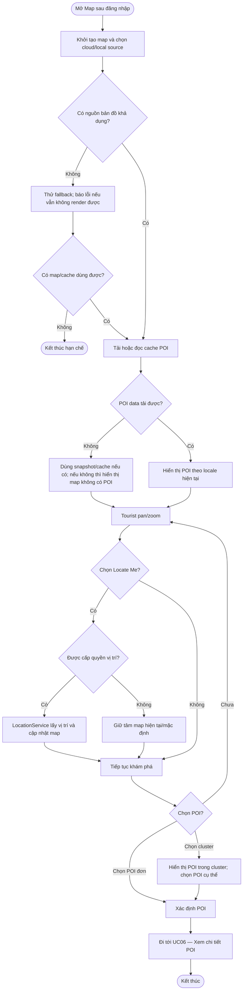

# UC05 — Khám phá bản đồ tương tác

**Actor:** Tourist  
**Precondition:** Có authenticated session.

**Ghi chú:** Cluster, pan/zoom và định vị là các nhánh của cùng UC; nguồn bản đồ có thể là MapLibre/cloud hoặc PMTiles/local pack.