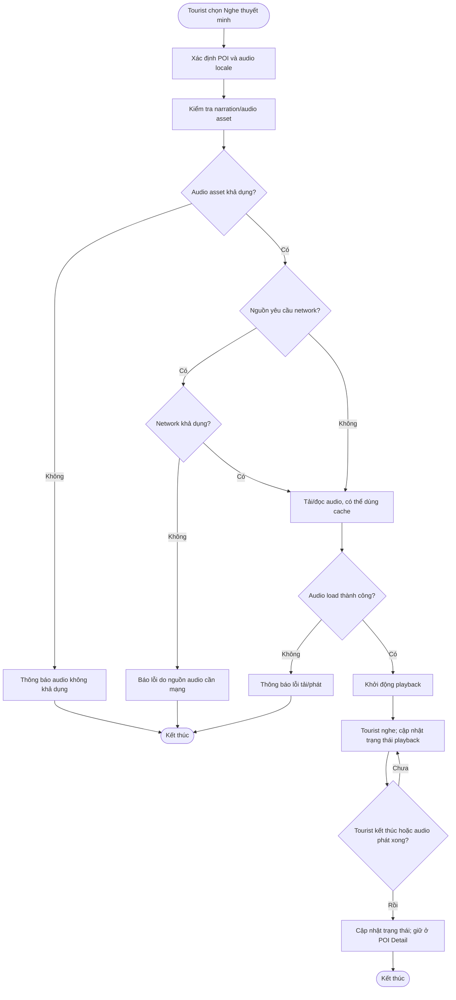

# UC07 — Nghe thuyết minh POI

**Actor:** Tourist  
**Điểm vào:** POI Detail có chức năng audio.

**Ngoại lệ:** Asset không khả dụng, lỗi tải/phát, hoặc network không khả dụng khi nguồn audio bắt buộc dùng network.