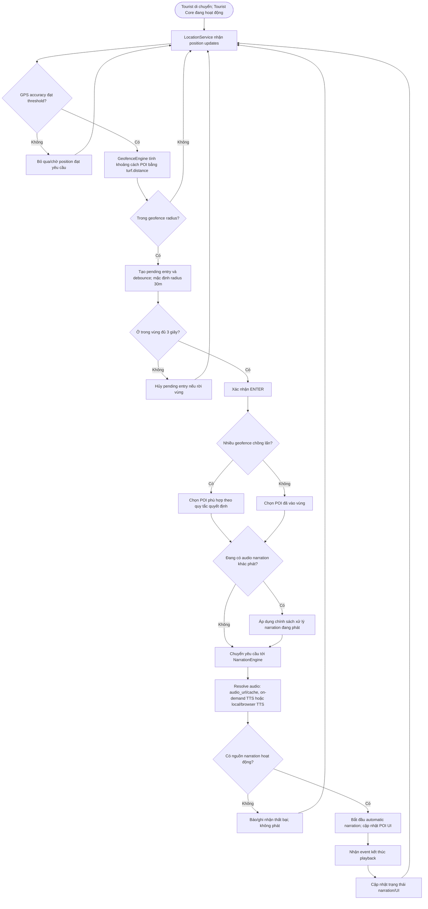

# UC08 — Nhận thuyết minh tự động theo vị trí

**Actor:** Tourist

**Ghi chú:** Sơ đồ giữ riêng UC08 với UC07; dùng chung cơ chế audio nhưng trigger là geofence. Các nguồn audio theo đặc tả gồm pre-generated, on-demand TTS/localization, realtime cloud TTS và local/browser TTS cho hybrid audio.