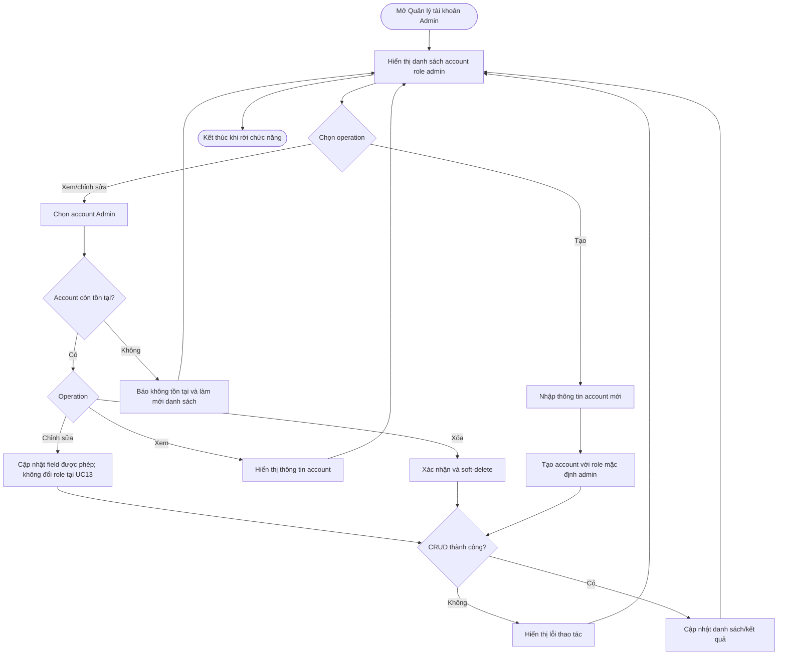

# UC13 — Quản lý tài khoản Admin

**Actor:** Super Admin  
**Phạm vi:** Chỉ các account có role `admin`; account mới mặc định role `admin`.

**Ghi chú:** Activate/Deactivate và reset password thuộc phạm vi UC13 theo đặc tả; gán/thay đổi role thuộc UC14.