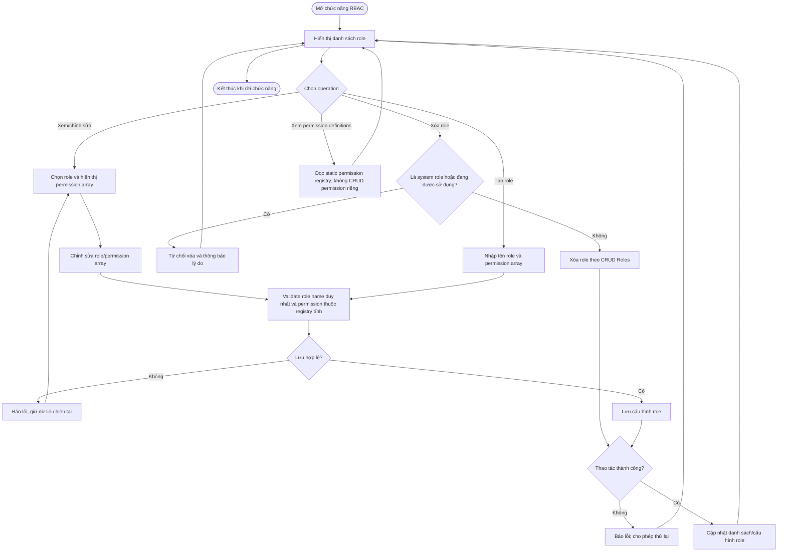

# UC14 — Quản lý vai trò và phân quyền (RBAC)

**Actor:** Super Admin

**Quy tắc:** Account có một role; không gán permission trực tiếp cho account. UC14 quản lý role và permission array, không CRUD định nghĩa permission tĩnh.