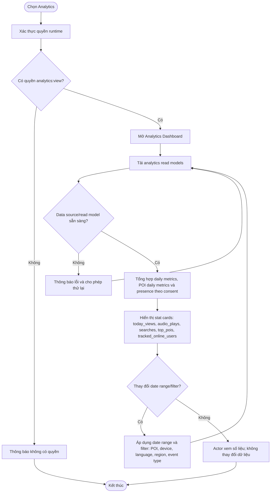

# UC15 — Xem Analytics

**Actor:** Admin, Super Admin  
**Precondition:** Đã xác thực và có quyền `analytics:view`.

**Giới hạn:** Dashboard dùng stat cards; không có drill-down, chart hoặc export trong UC15. `tracked_online_users` là anonymous devices đã consent trong sliding window.